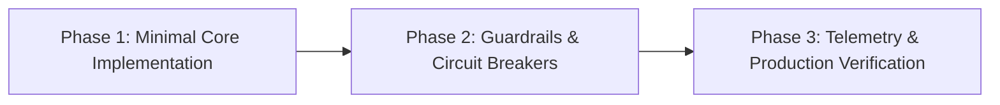

# Council Deliberation Report: {{DILEMMA_TITLE}}

**Date:** {{DATE}}  
**Convened By:** Antigravity Ask Council Framework  
**Council Seats:** 🏛️ Chief Systems Architect | 🔍 Devil's Advocate | ⚡ Pragmatic Staff Engineer | ⚖️ Council Chairman

---

## ⚖️ Executive Summary & Chairman's Verdict

> [!IMPORTANT]
> **The Binding Recommendation:**  
> **{{CHAIRMAN_FINAL_VERDICT}}**

### Core Rationale:
{{CHAIRMAN_RATIONALE}}

---

## 📊 Council Scorecard & Stances

| Council Seat | Primary Stance | Core Argument | Risk Assessment |
| :--- | :--- | :--- | :--- |
| 🏛️ **Chief Systems Architect** | {{ARCHITECT_STANCE}} | {{ARCHITECT_ARGUMENT_SUMMARY}} | Scalability & coupling: {{ARCHITECT_RISK}} |
| 🔍 **Devil's Advocate** | {{SKEPTIC_STANCE}} | {{SKEPTIC_ARGUMENT_SUMMARY}} | Failure modes: {{SKEPTIC_RISK}} |
| ⚡ **Pragmatic Staff Engineer** | {{PRAGMATIST_STANCE}} | {{PRAGMATIST_ARGUMENT_SUMMARY}} | Operational TCO: {{PRAGMATIST_RISK}} |

---

## 🔍 Detailed Councillor Perspectives

````carousel
### 🏛️ Chief Systems Architect
**Stance:** {{ARCHITECT_STANCE}}

#### Architectural Assessment:
{{ARCHITECT_BODY}}

#### Boundary & State Analysis:
{{ARCHITECT_BOUNDARIES}}
<!-- slide -->
### 🔍 Devil's Advocate / Red Teamer
**Severity Assessment:** {{SKEPTIC_SEVERITY}}

#### Critical Failure Modes (3:00 AM Scenarios):
{{SKEPTIC_FAILURES}}

#### Unexamined Assumptions:
{{SKEPTIC_ASSUMPTIONS}}
<!-- slide -->
### ⚡ Pragmatic Staff Engineer
**Pragmatic Recommendation:** {{PRAGMATIST_STANCE}}

#### Simplicity & YAGNI Audit:
{{PRAGMATIST_YAGNI}}

#### The "Boring Technology" Alternative:
{{PRAGMATIST_BORING_ALTERNATIVE}}
````

---

## ⚔️ Consensus vs. Contested Points

### 🤝 Unanimous Consensus (All Councillors Agree)
- [Point 1 where all seats align]
- [Point 2 where all seats align]

### ⚡ Central Tensions & Trade-Offs
| Tension | Perspective A | Perspective B | Chairman's Resolution |
| :--- | :--- | :--- | :--- |
| **Purity vs Velocity** | Architect wants clean decoupling layer | Pragmatist warns of unnecessary abstraction | Resolve by starting with a thin facade and refactoring if second consumer appears. |
| **Resilience vs Simplicity** | Skeptic warns of network partitions | Pragmatist notes current traffic does not justify distributed consensus | Use bounded retries with exponential backoff and circuit breaker, not complex 2PC. |

---

## 🛡️ Risk Radar & Required Mitigations

> [!WARNING]
> The Council identified the following critical risks that **must** be addressed if this path is taken:
> 1. **Risk:** {{RISK_1}}  
>    *Mitigation:* {{MITIGATION_1}}
> 2. **Risk:** {{RISK_2}}  
>    *Mitigation:* {{MITIGATION_2}}

---

## 🚀 Phased Implementation Roadmap



1. **Phase 1: Minimal Viable Implementation**
   - {{PHASE_1_STEPS}}
2. **Phase 2: Risk Mitigations & Edge-Case Protection**
   - {{PHASE_2_STEPS}}
3. **Phase 3: Validation & Monitoring**
   - {{PHASE_3_STEPS}}
